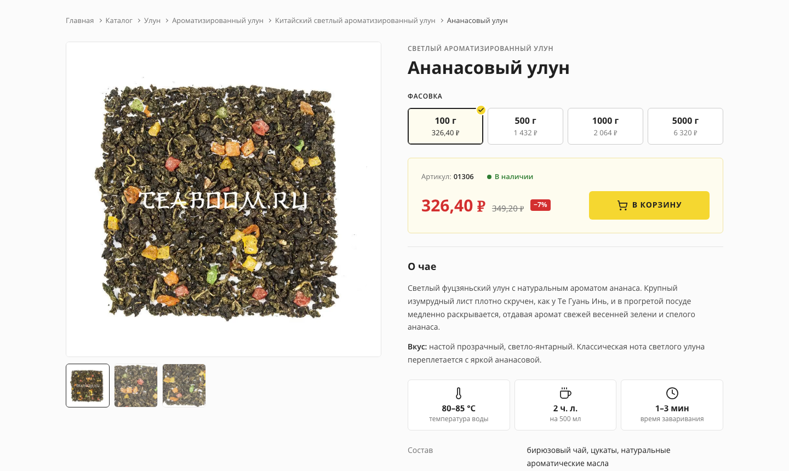
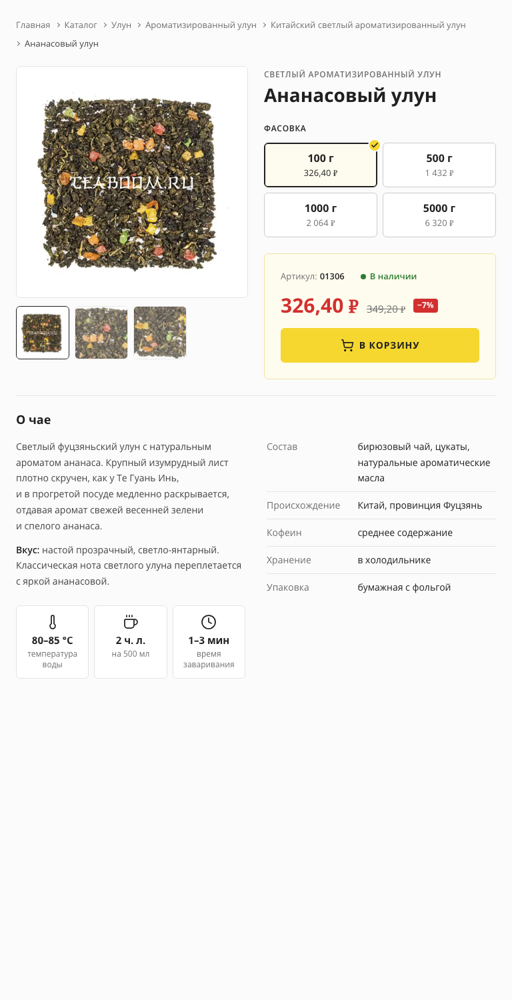
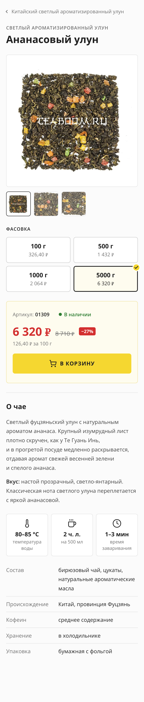
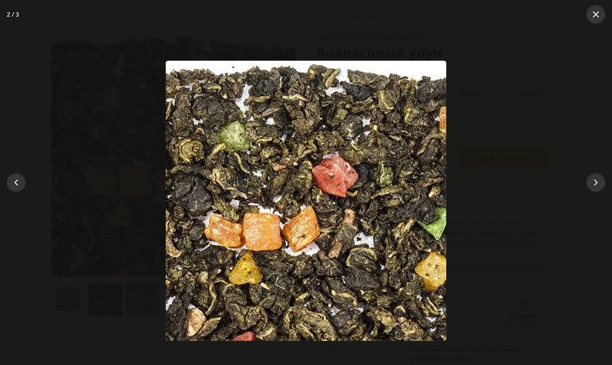

# Карточка товара «Ананасовый улун» — Teaboom.ru

Тестовое задание: верхняя часть карточки товара [teaboom.ru/product/ananasovij-ulun](https://teaboom.ru/product/ananasovij-ulun) — галерея фото с полноэкранным просмотром, категория, название, выбор фасовки, артикул, цена со скидкой, кнопка «В корзину» и короткое описание.

| Desktop, 1440 px | Tablet, 768 px | Mobile, 375 px |
| --- | --- | --- |
|  |  |  |

Полноэкранный просмотр фото:



## Запуск

Нужен Node.js 20.19+ или 22.12+.

```bash
npm install
npm run dev       # dev-сервер на http://localhost:5173
npm run build     # сборка в dist/
npm run preview   # просмотр собранной версии
npm run lint      # stylelint для SCSS
npm run images    # пересобрать фото товара из images-source/
```

Пути в `dist/` относительные, поэтому сборку можно выложить в любую папку на любом статическом хостинге. Публикация на GitHub Pages настроена в `.github/workflows/deploy.yml` (Settings → Pages → Source: GitHub Actions).

## Стек

- HTML5, SCSS (модули `@use`/`@forward`), JavaScript без фреймворков.
- [Vite](https://vite.dev/) — только для сборки SCSS, хешей ассетов и dev-сервера.
- Open Sans через [Fontsource](https://fontsource.org/) — шрифт с собственного хостинга, без запросов к Google Fonts.
- Иконки — inline SVG на основе [Lucide](https://lucide.dev/) (ISC).

Bootstrap и готовые шаблоны не используются.

## Структура

```
index.html                    разметка карточки + JSON-LD
src/
  scss/
    abstracts/                переменные (цвета, шрифты, брейкпоинты) и миксины
    base/                     reset, базовая типографика, .visually-hidden
    layout/                   контейнер страницы
    components/               по файлу на BEM-блок
    main.scss
  js/
    modules/gallery.js        основное фото и миниатюры
    modules/lightbox.js       полноэкранный просмотр
    modules/variant-picker.js переключение фасовки
    modules/add-to-cart.js    состояние кнопки «В корзину»
    utils/format-price.js     форматирование цен через Intl
    main.js
  assets/images/              AVIF + JPEG: 160 (миниатюры), 480 и 970 px
images-source/                исходные фото
scripts/optimize-images.js    генерация адаптивных изображений (sharp)
```

## Решения

**Стилистика.** Цвета, шрифт и брейкпоинты взяты из CSS действующего сайта: жёлтый `#f5d730`, текст `#444`/`#202020`, фон `#fbfbfb`, кремовый `#fefcef`, брейкпоинты 480/768/992/1200. Серый для второстепенного текста чуть темнее, чем на сайте (`#707070` вместо `#808080`), чтобы проходить контраст WCAG AA.

**Разметка.** `article` с `header`, `form` и `section`; один `h1`, описание — `h2`. Характеристики — `dl`, хлебные крошки — `nav` + `ol` с `aria-current`. Цена — элемент `<data value="…">`, старая цена — `<s>`. В `head` есть микроразметка Product с отдельным Offer на каждую фасовку.

**Фасовки — обычные radio-кнопки** внутри `fieldset`. Поэтому без доп. кода работают клавиатура (Tab, стрелки), скринридеры и отправка формы. Цена, старая цена и вес лежат в `data-атрибутах` — такую разметку легко выводить циклом в Django-шаблоне. Выбранная фасовка отмечается не только цветом, но и галочкой.

**Интерактив.** При смене фасовки обновляются цена, старая цена, скидка в процентах, артикул и цена за 100 г (для фасовок от 500 г — видна выгода). Выбор сохраняется в адресе (`?sku=01308`), так что ссылку на конкретную фасовку можно отправить. Если у фасовки нет скидки (`data-old-price` пустой), старая цена и бейдж скрываются. Кнопка «В корзину»: обычное, hover, active, focus-visible и «Добавлено» на 2,5 с; результат озвучивается через `role="status"`.

**Галерея.** Клик по миниатюре меняет основное фото, клик по основному фото открывает его на весь экран. Все слайды — настоящие `<picture>` в разметке (Django выводит их циклом), неактивные скрыты атрибутом `hidden` и загружаются лениво (`loading="lazy"`), поэтому не тратят трафик, пока их не открыли. Миниатюры — отдельные файлы по 160 px (4–6 КБ), а не уменьшенные полноразмерные фото.

Полноэкранный просмотр сделан на нативном `<dialog>` и `showModal()`: фокус удерживается внутри окна, Esc закрывает его, а после закрытия фокус возвращается на фото — всё это браузер делает сам. Листать можно стрелками на экране, клавишами ← → и свайпом; закрыть — кнопкой, Esc или кликом по пустому месту вокруг фото. Прокрутка страницы под окном блокируется. Листание в окне синхронизирует основное фото и миниатюры. Фото не растягивается больше своего реального размера. Если у товара одно фото, стрелки и счётчик скрываются.

**Адаптивность.** Mobile first. Порядок блоков в DOM совпадает с мобильным, а на больших экранах раскладка задаётся через `grid-template-areas`:

- **Desktop (≥ 992 px):** фото слева (липнет при прокрутке), справа название, покупка и описание.
- **Tablet (768–991 px):** фото и покупка в две колонки, описание на всю ширину и внутри делится на две колонки.
- **Mobile (< 768 px):** название над фото, чтобы сразу было понятно, что за товар; фасовки сеткой 2×2 с крупными зонами нажатия; кнопка на всю ширину; хлебные крошки сворачиваются в одну ссылку «назад» на родительскую категорию. Значок лупы на фото виден всегда (на устройствах с мышью — только при наведении), а стрелки в полноэкранном режиме переезжают вниз, под большой палец.

Блоки фасовок и покупки используют container queries: раскладка зависит от ширины самого блока, а не экрана, поэтому компонент одинаково ведёт себя в любой колонке.

**Производительность.** Фото — `picture` с AVIF (в 1,6–1,8 раза легче JPEG) и `srcset`/`sizes`; заданы `width`/`height`, поэтому нет сдвига макета (CLS). Главное фото — LCP-элемент, поэтому у него `fetchpriority="high"` и нет lazy-загрузки. Шрифты подключаются с `unicode-range`: браузер скачивает только латиницу, кириллицу и подмножество со знаком ₽. Итог: CSS — 6 КБ, JS — 2,2 КБ (gzip).

**Доступность.** Видимый `focus-visible` у всех интерактивных элементов, учтён `prefers-reduced-motion`, hover-эффекты включаются только на устройствах с мышью (`@media (hover: hover)`).

## Что упрощено

- Корзина не подключена — по заданию.
- У товара на сайте только одно фото. Чтобы показать работу галереи, второй и третий кадры — крупные планы, вырезанные из него же (`images-source/*-detail-*.jpg`). На реальном сайте их нужно заменить настоящими снимками: положить в `images-source/` и выполнить `npm run images`.
- Ссылки в хлебных крошках и на категорию — заглушки `#`.
